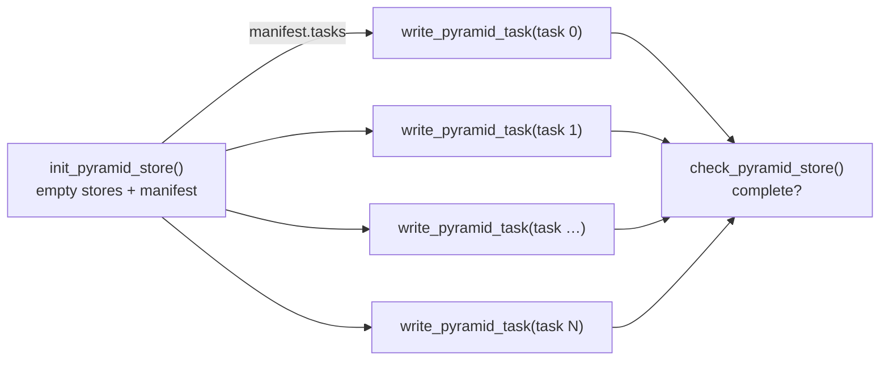

# Parallel Writes with a Manifest

[`save_pyramid`][grid_doctor.save_pyramid] writes a whole pyramid in one
dask computation on one machine.  That stops working when the source is
too large for the memory or the wall-clock limit of a single job, for
example decades of hourly data at HEALPix level 10 or above.  The
answer is to split the work into many small, independent jobs: one job
creates empty stores and decides how the work is cut, an array job fills
the stores in parallel, and a last job checks that nothing is missing.

grid-doctor supports exactly this pattern through a **manifest**:



1. **Init** ([`init_pyramid_store`][grid_doctor.init_pyramid_store])
   writes every level store with its metadata, encodings and
   coordinates, but no data.  It returns a
   [`PyramidManifest`][grid_doctor.PyramidManifest]: the layout of the
   stores plus a list of [`WriteTask`][grid_doctor.WriteTask] work
   units.  Each task names the variables and the index region one
   worker has to write.
2. **Write** ([`write_pyramid_task`][grid_doctor.write_pyramid_task]) is
   called once per task, by any number of workers, in any order, on any
   number of nodes.  No locking is needed: tasks never share a zarr
   chunk.
3. **Check** ([`check_pyramid_store`][grid_doctor.check_pyramid_store])
   reports which tasks have finished and whether the stores still look
   like the manifest says.  Missing tasks can be retried individually.

The manifest and the tasks are plain, frozen dataclasses that serialise
to JSON.  They can be returned from one
[reflow](https://reflow-hpc.org) job and fed into the next one without
any glue code, which is what the [reflow section](#running-it-with-reflow)
below shows.

## Quick start

Everything in one process, to show the moving parts.  On an HPC system
each loop iteration would be one array-job element.

```python
import xarray as xr
import grid_doctor as gd

source = xr.open_mfdataset("/pool/data/ERA5/.../tas_*.nc", chunks={"time": 24})
pyramid = gd.create_healpix_pyramid(source, max_level=9)  # lazy

# 1. Empty stores + plan: tasks of 72 time steps each.
manifest = gd.init_pyramid_store(pyramid, "/scratch/project/era5", split={"time": 72})
print(len(manifest.tasks), "tasks")

# 2. One call per task (this is what the array job does).
for task in manifest.tasks:
    gd.write_pyramid_task(pyramid, task)

# 3. Did everything arrive?
report = gd.check_pyramid_store(manifest)
print(report.summary())
report.raise_if_incomplete()
```

The result is identical, attribute for attribute and value for value,
to what `save_pyramid(pyramid, path, mode="w")` would have written.

## The manifest

### What it contains

This is (an excerpt of) the manifest for one month of hourly data with
two time-dependent variables and a static land fraction, at levels 9 to
7, split into tasks of 72 time steps:

```json
{
  "schema_version": 1,
  "manifest_id": "d28efd88124c404ebbbacb99d5f44b6b",
  "path": "/scratch/project/era5_202001",
  "zarr_format": 2,
  "created": "2026-10-27T09:50:54+00:00",
  "grid_doctor_version": "2604.0.0",
  "split": {"time": 72},
  "materialised": [],
  "levels": [
    {
      "level": 9,
      "store": "level_9.zarr",
      "coords": ["time"],
      "data_vars": [
        {"name": "tas",   "dims": ["time", "cell"], "shape": [744, 3145728], "chunks": [24, 65536], "dtype": "float32"},
        {"name": "pr",    "dims": ["time", "cell"], "shape": [744, 3145728], "chunks": [24, 65536], "dtype": "float32"},
        {"name": "sftlf", "dims": ["cell"],         "shape": [3145728],      "chunks": [65536],     "dtype": "float32"}
      ]
    }
  ],
  "tasks": [
    {"task_id": "task-000000", "variables": ["tas", "pr"], "region": {"time": [0, 72]},   "levels": [9, 8, 7]},
    {"task_id": "task-000001", "variables": ["tas", "pr"], "region": {"time": [72, 144]}, "levels": [9, 8, 7]},
    {"task_id": "task-000011", "variables": ["sftlf"],     "region": {},                  "levels": [9, 8, 7]}
  ]
}
```

#### Manifest fields

| Field | Meaning |
|---|---|
| `schema_version` | Layout version of this JSON.  A grid-doctor that does not know the version refuses to read it instead of guessing. |
| `manifest_id` | Random id created by every init.  Every task and every completion marker carries it, which is how stale work is recognised after a re-init. |
| `path` | Pyramid root as passed to `init_pyramid_store`. |
| `zarr_format` | Zarr format (2 or 3) of all level stores. |
| `created` | UTC timestamp of the init. |
| `grid_doctor_version` | Version that wrote the manifest. |
| `split` | **Effective** task size per split dimension, after rounding (see [planning](#how-tasks-are-planned)).  Empty when nothing was split. |
| `materialised` | Data variables the init wrote completely itself (`materialise=`). |
| `levels` | One entry per level, finest first. |
| `tasks` | All work units.  Together they cover every data variable on every level exactly once. |

#### Level fields

| Field | Meaning |
|---|---|
| `level` | HEALPix refinement level. |
| `store` | Store name relative to `path`. |
| `coords` | Arrays the init wrote completely (coordinates, `crs`, materialised variables).  Workers never touch them. |
| `data_vars` | Arrays that tasks write, with `dims`, full `shape`, on-disk `dtype` and `chunks`. |

`chunks` is the **write unit**: the shard shape for sharded zarr v3
arrays, the chunk shape otherwise.  It is read back from the store after
the init, so it reflects what the stores really contain, not what was
requested.

#### Task fields

| Field | Meaning |
|---|---|
| `task_id` | Unique within the manifest; also the name of the completion marker. |
| `variables` | Data variables this task writes. |
| `region` | Half-open index range per split dimension, `{"time": [0, 72]}` means `time` indices 0 to 71.  Dimensions that are not listed are written in full.  An empty region means "the whole array" (variables without any split dimension). |
| `levels` | Levels the task writes, finest first.  A task always covers all levels of its variables, because coarse levels are derived from the finest one. |

Inside the manifest file the tasks omit the fields they share with the
manifest.  A task on its own (`task.to_json()`) also carries
`manifest_id`, `path` and `zarr_format`, so that it is self-contained:
a worker needs nothing but the task, the data and, for S3, credentials.

### Where it is stored

The init writes the manifest next to the level stores, and every
finished task leaves a small marker there:

```text
<path>/
├── level_9.zarr/
├── level_8.zarr/
├── level_7.zarr/
└── _grid_doctor/
    ├── init.json             # only while an init runs (or after it was killed)
    ├── manifest.json         # written last by the init
    └── done/
        ├── task-000000.json  # one marker per finished task
        └── ...
```

A marker records the task id, the manifest id, the host, the finish
time and the elapsed seconds, which is handy when you want to know where
and how long a task ran.

The manifest is written **after** all level stores exist, so its
presence means the init finished.  A re-init deletes the old manifest
and all markers **before** touching the stores, so workers of an
earlier run fail immediately instead of writing into the new stores.

`init.json` is written when an init starts and removed right after the
manifest.  It records the start time, host, process id and, inside a
Slurm job, `SLURM_JOB_ID`.  If it is still there without a manifest, the
init was killed (time limit, `scancel`, node failure) or is still
running, and the error messages of `load_manifest`, `check_pyramid_store`
and `init_pyramid_store` say so, for example:

```text
ManifestError: no manifest at /scratch/project/era5: an init started
2026-10-27T11:02:13+00:00 on host l40123 (Slurm job 4711) has not
finished; it is still running or was killed
```

### Serialisation

```python
text = manifest.to_json()                     # str, pretty-printed
manifest = gd.PyramidManifest.from_json(text)

task_json = manifest.tasks[3].to_json()       # self-contained task
task = gd.WriteTask.from_json(task_json)

manifest = gd.load_manifest("/scratch/project/era5")  # read the stored copy
```

All classes are frozen dataclasses built only from `str`, `int` and
`tuple`.  That has two consequences:

- reflow's manifest codec serialises them natively.  A job can return a
  `PyramidManifest`, a `WriteTask` or `list[WriteTask]` and the next job
  receives the same object back, type and all.
- They are hashable and compare by value, so `task in done_tasks` and
  using tasks as dictionary keys just work.

`task.slices` (or `task.isel()`) turns the region into a mapping that
`Dataset.isel` understands: `{"time": slice(0, 72)}`.

### Validation

There is no separate JSON Schema file.  Instead every object validates
itself when it is created, in `__post_init__`.  That matters because
manifests and tasks arrive by three routes: parsed from JSON
(`from_json`, `load_manifest`), rebuilt by reflow's codec (which calls
the constructor directly and never goes through `from_json`), or built
by hand.  A JSON Schema would only cover the first one.

Each class checks its own fields:

| Class | Checks |
|---|---|
| `ArraySpec` | `name` is a valid array name; `dims` unique strings; `shape` integers ≥ 0; `chunks` integers ≥ 1; `dims`, `shape` and `chunks` of equal length. |
| `LevelSpec` | `level` ≥ 0; `store` is a plain name (no `/`, no leading `.`); unique data variables; no name both coordinate and data variable. |
| `WriteTask` | `task_id` and `manifest_id` are plain names (they become file names); `zarr_format` is 2 or 3; `variables` non-empty and unique; `region` entries well formed with `0 ≤ start ≤ stop`; `levels` non-empty and unique. |
| `PyramidManifest` | `schema_version` is supported; `split` sizes ≥ 1 and not along `cell`; plus the consistency checks below. |

The manifest additionally checks that its tasks fit its layout, which
is the property parallel writes depend on:

- every task's `manifest_id`, `path` and `zarr_format` match the
  manifest's, and task ids are unique;
- every task level and variable exists, and region dimensions are
  split dimensions the variable actually has;
- every region lies inside the array and starts and ends on write-unit
  boundaries (or at the array end);
- for each data variable on each level, the task regions **tile the
  array exactly as a grid**: per split dimension the intervals cover
  the dimension end to end without overlap, every combination of
  intervals occurs exactly once, and every data variable is written by
  at least one task.  The order of the entries inside a region does not
  matter.  Irregular tilings that are not grids are rejected even if
  they do not overlap, since the planner never produces them.

The tiling check is linear in the number of tasks; a manifest for ten
years of hourly data in daily tasks (3650 tasks, 4 variables, 10 levels)
parses and validates in well under a second.

Strings must be strings and integers must be integers: `"72"` is not
accepted for 72, `true` is not accepted as 1, and `"time"` is not
accepted where a list of dimensions is expected.  Lists are converted to
tuples, so a hand-built `WriteTask(..., variables=["tas"])` compares
equal to one built with `("tas",)`.

Violations raise `ManifestError` with the location of the problem, for
example:

```text
ManifestError: tasks[3]: missing field 'levels'
ManifestError: task 'task-000004': region start 3 is not a multiple of the write unit 24 of 'tas' on level 9 along 'time'
ManifestError: manifest: 'pr' on level 7: task intervals along 'time' overlap at index 48; ...
```

`schema_version` remains the compatibility contract.  It is checked
first, so a manifest from an incompatible grid-doctor fails with
"re-initialise the store" rather than with a missing field.

## How tasks are planned

Parallel writes are only safe if no two writers ever touch the same zarr
chunk.  Zarr writes a chunk by reading it, modifying the part that
changed and writing it back; two writers doing that at the same time
lose one of the updates, silently.  The planner therefore cuts regions
only at chunk boundaries.

### `split`: the task size

`split={"time": 72}` asks for tasks of 72 time steps.  The size is
rounded **up** to a multiple of the least common multiple of the write
units of all arrays along that dimension, on all levels:

| Arrays along `time` | Requested | Effective | Why |
|---|---|---|---|
| all chunked by 24 | 72 | 72 | already a multiple of 24 |
| all chunked by 24 | 50 | 72 | next multiple of 24 |
| `tas` by 2, `pr` by 3 | 4 | 6 | lcm(2, 3) = 6 |
| sharded, shard 48, chunk 24 | 24 | 48 | shards are the write unit |

Rounding is logged at `INFO` level, and the effective sizes end up in
`manifest.split`.  The last region along a dimension may be shorter
(744 = 10 × 72 + 24, so the eleventh time task covers 24 steps).

Several split dimensions give the cartesian product of their regions:
`split={"time": 72, "plev": 4}` on 744 time steps and 12 pressure levels
gives 11 × 3 = 33 regions.

!!! warning "Splitting along `cell` is not supported"
    Every pyramid level is derived from the finest one by aggregating
    four children per parent.  A `cell` region of the finest level
    becomes a 4ᵏ times smaller region on a level k steps coarser, which
    is generally no longer chunk-aligned.  `init_pyramid_store` rejects
    `split={"cell": ...}` with a `ManifestError`.  Split along time,
    ensemble member, vertical level or any other non-spatial dimension.

### Which variables go into a task

Variables are grouped by the split dimensions they have (and the levels
they appear on):

- All variables with the same split dimensions share a task, so a
  worker reads and regrids the source region once for all of them.
  `variables_per_task=1` gives one task per variable instead, which
  lowers the memory per worker at the price of reading the source
  several times.
- Variables without any split dimension (a static land-sea mask, a 0-d
  scale factor) get their own task with an empty region.  They are
  written exactly once.  Small static fields can instead be written by
  the init itself with `materialise=["sftlf"]`; they then appear in the
  level's `coords` and in no task.
- `split=None` (the default) plans a single task per variable group that
  covers the whole store.  This is the degenerate case and mostly useful
  for testing.

### What the init does not compute

Only coordinates and `materialise` variables are computed at init
time.  For lazy data variables the init
writes metadata only, so it takes seconds even for stores with hundreds
of thousands of chunks.  The pyramid passed to the init therefore only
needs the correct shapes, dtypes, chunks, encodings and attributes; you
can build it lazily from the full source without fear.

## When the target already exists

A second init on the same path is the one thing that can destroy work:
it re-creates every level store.  `init_pyramid_store` therefore checks
the target first and lets you choose with `if_exists`:

| `if_exists` | Target is empty | Target has a pyramid with a manifest | Target has stores but no manifest (killed init, `save_pyramid` output) |
|---|---|---|---|
| `"error"` (default) | initialise | `StoreExistsError` | `StoreExistsError` |
| `"resume"` | initialise | return the stored manifest if the plan matches, else `StoreExistsError` | `StoreExistsError` |
| `"overwrite"` | initialise | re-initialise, new `manifest_id` | re-initialise |

**Resume** plans the tasks again from the pyramid you pass and the
chunking of the stores that already exist, and compares the result with
the stored manifest: path, zarr format, levels, array names, dims,
shapes, chunks and dtypes, `materialise`, the effective `split` and every
task's variables, region and levels.  It also compares the **coordinate
values** the init wrote (time, vertical levels, members, ...), so a
pyramid of another time range with the same length is refused rather
than resumed under the old labels.  If everything matches it returns
the stored manifest **unchanged, with its `manifest_id`**, and writes
nothing.  Tasks that already finished keep their markers.  If anything
differs, it raises and lists the differences:

```text
StoreExistsError: cannot resume /scratch/project/era5: the stored
manifest d28efd88… was planned differently (split {'time': 72} !=
{'time': 48}). Use if_exists='overwrite' to discard it and start over.

StoreExistsError: cannot resume /scratch/project/era5: the stored
manifest d28efd88… was planned differently (level 9: coordinate 'time'
differs at time=0: pyramid has 2021-01-01T00:00:00, store has
2020-01-01T00:00:00). Use if_exists='overwrite' ...
```

What resume cannot see is a change in the *data* under unchanged labels
(the same time steps re-processed with a fixed input file, say).  In
that case overwrite.

That makes re-submitting a conversion after a time-out safe and cheap:
same parameters resume where the last run stopped, different parameters
fail loudly instead of wiping the store.  Two accidental submissions with
the same parameters running at the same time are harmless as well, since
they write identical data into identical, chunk-aligned regions.

A moved or copied store cannot be resumed (its manifest records the old
path, which is where workers would write).  Use `"overwrite"` there.

**Overwrite** must not be used while another conversion into the same
path is running.  Workers of the old run that have not started fail with
`StaleTaskError`.  A worker that was already writing cannot be stopped
from writing into the new stores, but it re-checks the manifest after
writing and fails with `StaleTaskError` ("re-initialised while
task-… was writing") instead of reporting success.  If you ever see that
message, overwrite once more and let only one run write.

The `_grid_doctor/` directory is not part of any zarr store and does not
disturb readers.  Once a store is complete and published you may delete
it; you only lose the ability to run `check_pyramid_store` against it.

## Writing a task

```python
gd.write_pyramid_task(pyramid, task, s3_options=None)
```

### Full or pre-subset pyramid

The pyramid a worker passes can have either shape along the split
dimensions:

- **Full extent**: the same lazy pyramid as at init time.  The task
  region is selected inside `write_pyramid_task`.  Simple, but every
  worker builds the full dask graph.
- **Only the task region** (recommended): subset the *source* first and
  build the pyramid from that.  Each worker opens, reads and regrids only
  its slice.

```python
source = xr.open_mfdataset(files, chunks={"time": 24})
pyramid = gd.create_healpix_pyramid(source.isel(task.isel()), max_level=9)
gd.write_pyramid_task(pyramid, task)
```

For every split dimension, the length must be either the full length
recorded in the manifest or exactly the region length; anything else is
a `ManifestError`.  The pyramid may contain extra variables or levels;
they are ignored.

### What is validated before anything is written

1. The stored manifest has the task's `manifest_id`.  If the store was
   re-initialised since the task was planned, a `StaleTaskError` is
   raised and nothing is written.
2. The task is identical to the task with the same id in the stored
   manifest.  The manifest guarantees that *its* tasks are chunk-aligned
   and disjoint; an edited or hand-built task has no such guarantee and
   is refused with a `ManifestError`.
3. Every level and variable of the task exists in the pyramid.
4. Dimension names match the store (dimension order may differ; the
   data is transposed).
5. Non-split dimensions have exactly the stored length.
6. The coordinate values in the task region match the ones the init
   stored.  Workers never write coordinates, so a pyramid built from
   another time range of the same length would otherwise put its data
   under the stored labels.  Values are encoded the way they are stored
   (units, dtype, packing) and compared exactly; arrays along `cell`
   (`cell`, `latitude`, `longitude`) are skipped, since they follow from
   the HEALPix index.

After the data is stored and before the completion marker is written,
the worker reads the manifest id once more.  If the store was
re-initialised in the meantime, it raises `StaleTaskError` and writes no
marker (see [overwrite](#when-the-target-already-exists)).

### Chunk alignment inside a task

`da.store` writes every dask block independently.  If a worker's dask
chunks do not line up with the store's chunks (for example the init
pyramid was chunked `time=24` and the worker opened the source with
`time=10`), two blocks would share a zarr chunk and race.  The worker
detects this, logs a warning starting with `Rechunking ...` and rechunks
to the store's write units.  Correctness is preserved, but rechunking
costs memory and time, so open the source with the same chunks in both
steps if you see the warning.

### Retries and idempotency

A task writes the same values into the same region every time it runs.
Running a task twice, or running a task whose first attempt crashed
halfway, is harmless.  The completion marker is written only after all
data of the task has been stored, so a crashed task never looks done.

A job killed by Slurm in the middle of a write (time limit, `scancel`)
can leave a truncated chunk file on a POSIX file system; S3 uploads are
atomic, so there it cannot.  Because regions are chunk-aligned, the
retry rewrites every chunk of its region completely, without reading the
old content, which replaces the broken file (or deletes it, if the new
chunk is all fill value).  The marker itself is written atomically
(temporary file plus rename, or a single upload), so it is either
complete or absent.

### Return value

`write_pyramid_task` returns the task itself.  That sounds odd but is
deliberate: in reflow, the output of the array job is then a
`WriteTask`, which [`is_task_done`][grid_doctor.is_task_done] can verify
on a cache hit (see below).

### S3

Pass the credentials to every call with `s3_options`, exactly as for
`save_pyramid`.  Credentials are never written to the manifest, the
tasks or the markers:

```python
s3_options = gd.get_s3_options("https://s3.eu-dkrz-3.dkrz.cloud", "~/.s3-credentials.json")
manifest = gd.init_pyramid_store(pyramid, "s3://bucket/era5", s3_options, split={"time": 72})
gd.write_pyramid_task(pyramid, task, s3_options)
gd.check_pyramid_store(manifest, s3_options)
```

## Checking completeness

```python
report = gd.check_pyramid_store(manifest)          # or the path: "/scratch/project/era5"
report.complete           # True / False, also bool(report)
report.done_tasks         # ("task-000000", ...)
report.missing_tasks      # tasks without a valid marker
report.problems           # structural problems, see below
print(report.summary())
report.raise_if_incomplete()   # IncompleteStoreError with the summary
```

The check reads level metadata and lists the marker directory.  It
never reads data, so it is fast even for very large stores.  A store is
complete when all of the following hold:

1. **Same manifest.** The stored `manifest.json` has the id being
   checked.  If not, the store was re-initialised and this manifest's
   markers mean nothing.
2. **Same layout.** Every level store opens, and every array and
   coordinate listed in the manifest exists with the recorded shape,
   write unit and dtype.  Violations end up in `report.problems`.
3. **All tasks done.** Every task has a marker with the right
   `manifest_id`.  Markers of other manifests and unreadable markers are
   counted in `report.stale_markers` and otherwise ignored.

### Why markers and not chunks?

The obvious alternative, "every chunk of the region exists", does not
work: zarr does not store chunks that contain only the fill value.  For
regional data (CORDEX on a global HEALPix grid), ocean-only variables
over land, or any masked field, most chunks are legitimately absent, and
there is no way to distinguish "never written" from "written, but all
NaN".  A marker written after the data is unambiguous.

If you still want to look at chunks, `inspect_chunks=True` lists the
stored chunk keys and reports, per finished task, how many chunks of its
region are absent in `report.absent_chunks` as
`(task_id, absent, expected)`.  This is **informational** and never makes
a store incomplete.  A task of a global, gap-free field with absent
chunks is suspicious; a task over the Sahara of an SST field with all
chunks absent is not.  The option lists every object of the inspected
arrays, which can take a while on large S3 stores.

### Retrying only what is missing

```python
report = gd.check_pyramid_store(manifest)
for task in manifest.select_tasks(report.missing_tasks):
    gd.write_pyramid_task(pyramid, task)
```

`select_tasks` returns the tasks in manifest order and raises `KeyError`
for unknown ids.

## Running it with reflow

The three steps map onto three reflow jobs.  The init returns
`list(manifest.tasks)`, which reflow fans out into one array element per
task; the `write` array job hands its tasks to a final `check` job,
which fails the workflow if anything is missing.

```python
"""convert_era5.py: ERA5 to HEALPix with one array element per task."""

from typing import Annotated

import xarray as xr
from reflow import Param, Result, Workflow

import grid_doctor as gd

wf = Workflow("era5-healpix")


def build_pyramid(
    source: str, max_level: int, region: dict[str, slice] | None = None
) -> dict[int, xr.Dataset]:
    """Same pyramid in every job; workers pass their task region."""
    ds = xr.open_mfdataset(source, chunks={"time": 24}, parallel=True)
    if region:
        ds = ds.isel(region)
    return gd.create_healpix_pyramid(ds, max_level=max_level, method="conservative")


# Not cached: see "Caching" below.
@wf.job(cache=False, cpus=4, mem="16G", time="00:30:00")
def init(
    source: Annotated[str, Param(help="Glob of input files")],
    target: Annotated[str, Param(help="Pyramid root, local path or s3://")],
    max_level: Annotated[int, Param(help="Finest HEALPix level")] = 9,
    time_per_task: Annotated[int, Param(help="Time steps per array element")] = 72,
    overwrite: Annotated[bool, Param(help="Discard an existing store")] = False,
) -> list[gd.WriteTask]:
    manifest = gd.init_pyramid_store(
        build_pyramid(source, max_level),
        target,
        split={"time": time_per_task},
        # A re-submit continues an existing store; changed parameters fail.
        if_exists="overwrite" if overwrite else "resume",
    )
    return list(manifest.tasks)


@wf.job(
    array=True,
    array_parallelism=64,
    cpus=16,
    mem="64G",
    time="02:00:00",
    verify=gd.is_task_done,
)
def write(
    task: Annotated[gd.WriteTask, Result(step="init")],
    source: Annotated[str, Param(help="Glob of input files")],
    max_level: Annotated[int, Param(help="Finest HEALPix level")] = 9,
) -> gd.WriteTask:
    pyramid = build_pyramid(source, max_level, task.isel())
    return gd.write_pyramid_task(pyramid, task)


@wf.job(cpus=1, mem="4G", time="00:10:00")
def check(
    done: Annotated[list[gd.WriteTask], Result(step="write")],
    target: Annotated[str, Param(help="Pyramid root, local path or s3://")],
) -> gd.StoreReport:
    report = gd.check_pyramid_store(target)
    report.raise_if_incomplete()
    return report


if __name__ == "__main__":
    wf.cli()
```

Submit and follow it like any reflow workflow:

```console
$ python convert_era5.py submit --run-dir /scratch/project/runs \
      --source '/pool/data/ERA5/E5/sf/an/1H/167/*.nc' \
      --target /scratch/project/era5_t2m --max-level 10 --time-per-task 168
$ python convert_era5.py status <run-id>
$ python convert_era5.py retry <run-id> --task write   # only the failed elements
```

Notes on the design:

- **Each `WriteTask` is self-contained.**  The array job does not need
  the manifest; reflow passes each element its own task.  If a later job
  needs the full manifest, call `gd.load_manifest(target)` there, or
  return the manifest from a separate job and pass it with
  `Result(step=..., broadcast=True)`.
- **Choose `time_per_task` by memory and wall-clock, not by node count.**
  Each element regrids `time_per_task` steps of the source at
  `max_level`.  Measure one element interactively first, then size the
  others.  Many short elements also make retries cheaper.
- **`array_parallelism`** caps how many elements run at once.  Use it to
  protect the file system or an S3 endpoint from too many concurrent
  writers.
- **S3:** read credentials inside each job (for example with
  [`get_s3_options`][grid_doctor.get_s3_options]) and pass them to all
  three calls.  Do not pass secrets as reflow `Param`s; those end up in
  the run database.

### Caching

reflow skips a job whose identity (name, version, inputs, upstream
outputs) it has seen before.  Two things to know:

- **The init job is declared with `cache=False`.**  In reflow 2604.4 the
  `Param` values of a job are not part of its cache identity.  A cached
  init would therefore return the tasks of the *previous* target even if
  you change `--target`, and the array job would write into the old
  store.  With `cache=False`, every `submit` runs the init again; with
  `if_exists="resume"` that is cheap and returns the stored manifest, so
  the tasks (and their manifest id) are the same as last time.
- **A re-submit only redoes what is missing.**  Because the tasks are
  identical, reflow finds the write elements that succeeded last time in
  its cache and skips them; only failed or timed-out elements run again.
  `retry <run-id> --task write` does the same within one run.  To start
  over deliberately, submit with `--overwrite`.
- **`verify=gd.is_task_done` on the array job.**  A write element is
  cached by its task, and every task carries the manifest id, so a
  re-initialised store never reuses old results.  On a cache hit with
  verification enabled, `is_task_done` additionally confirms that the
  marker is still in the store (it was not deleted, the store was not
  re-initialised by someone else).  For a manifest-returning job,
  [`is_current`][grid_doctor.is_current] does the same for the manifest.

### Local testing

`wf.run_local(run_dir=..., source=..., target=...)` runs the whole
workflow in one process, which is the quickest way to try a conversion on
a small time range.  With `max_workers > 1`, reflow runs array elements
in a process pool.  On Linux the default *fork* start method can
deadlock once dask, numba or zarr threads exist in the parent; switch to
spawn before running locally:

```python
import multiprocessing
multiprocessing.set_start_method("spawn", force=True)
run = wf.run_local(run_dir="/tmp/run", max_workers=4, source=..., target=...)
```

On a cluster every array element is its own process, so this does not
apply there.

## Re-running and recovering

| Situation | What to do |
|---|---|
| A few array elements failed (time limit, node failure) | `check_pyramid_store` lists them in `missing_tasks`.  In reflow: `retry <run-id> --task write`, or `submit` again with the same parameters.  By hand: `manifest.select_tasks(report.missing_tasks)`.  Partially written regions are rewritten completely by the retry. |
| The whole run was cancelled or the dispatcher died | `submit` again with the same parameters.  The init resumes the stored manifest and only missing tasks run. |
| The init job hit its time limit | There is no manifest, only `init.json` and partial stores; nothing else ran.  Give the init more time and `submit --overwrite`. |
| A task ran twice | Nothing.  Writes are idempotent. |
| You want a different `split` or `variables_per_task` | Run the init with `if_exists="overwrite"` (`--overwrite`).  All written data is discarded and a new manifest is created.  `"resume"` refuses and lists what changed. |
| The source data changed | Overwrite.  Resume notices changed layouts (shapes, chunks, variables) and changed coordinate labels (another time range), not changed values under the same labels. |
| Workers from an old run are still in the queue after a re-init | They fail with `StaleTaskError` without writing anything.  Cancel them. |
| The store was deleted | `check_pyramid_store` reports problems; `is_current` returns `False`.  Run the init again. |
| You want to publish the finished store | Optionally delete `<path>/_grid_doctor/`.  Readers never look at it. |

## Troubleshooting

| Error or symptom | Cause | Fix |
|---|---|---|
| `ManifestError: no manifest at .../_grid_doctor/manifest.json` | The init has not finished, failed, or the path differs. | Check the init job and the `path`. |
| `StaleTaskError: task-… belongs to manifest …` | The store was re-initialised after the task was planned. | Use tasks from the new manifest. |
| `StaleTaskError: … re-initialised while task-… was writing` | An overwrite happened while this worker was writing. | Overwrite again and let only one run write into the path. |
| `StoreExistsError: … already holds a pyramid` | `if_exists="error"` (the default) and the target is not empty. | `"resume"` to continue, `"overwrite"` to start over. |
| `StoreExistsError: cannot resume …: … planned differently (…)` | The parameters or the source layout changed since the init. | Restore the parameters, or overwrite. |
| `StoreExistsError: cannot resume …: there is no readable manifest (… has not finished …)` | The previous init was killed, or the path holds a store not written by `init_pyramid_store`. | Overwrite. |
| `ManifestError: tasks[3]: missing field '…'` or `… must be …` | The manifest file (or a task passed through JSON) is truncated or was edited. | Re-initialise, or fix the named field. |
| `ManifestError: … intervals along 'time' overlap` / `… gap along 'time'` or `… not a multiple of the write unit` | A manifest whose tasks no longer tile the arrays, typically after hand-editing. | Re-initialise; never edit regions by hand. |
| `ManifestError: task-…: the pyramid does not match the coordinates stored by the init …` | The worker built its pyramid from other data than the init (another time range, other levels), or subset it differently from `task.isel()`. | Build workers from the same source as the init, subset with `task.isel()`. |
| `ManifestError: task-… differs from the task stored in the manifest` | The worker received a task that is not the one the manifest planned. | Pass the tasks from `manifest.tasks` unchanged. |
| `ManifestError: cannot split along 'cell'` | `split` contains a spatial dimension. | Split along a non-spatial dimension. |
| `ManifestError: dimension 'time' has different lengths across variables/levels` | Levels or variables disagree on the split dimension. | All levels of a pyramid must share it; check the source. |
| `ManifestError: … expected the full length N or the task region length M` | The worker built its pyramid from a different subset than the task region. | Subset with `source.isel(task.isel())`, nothing else. |
| `ManifestError: … has dims … the store expects …` | Variable built differently in the worker than at init. | Use the same `build_pyramid` in both steps. |
| Warning `Rechunking 'tas' to the store's write units` | Worker chunks differ from init chunks. | Open the source with the same chunks in both steps. |
| `split[...]=N rounded up to M` in the log | `N` is not a multiple of the chunk size. | Expected; pick a multiple to avoid surprises. |
| Store complete but values all NaN in a region | The source has no data there, or the pyramid was built from the wrong source. | Compare `report.absent_chunks` with your expectations. |

## Limitations

- Splitting is supported along non-spatial dimensions only.
- All levels of the pyramid must share the length of every split
  dimension.
- A variable that has no split dimension is written by a single task.
  For very large static fields at high levels that task is
  correspondingly large; `materialise` or a separate run are the
  options.
- The manifest describes data variables only.  Coordinates are written
  completely by the init and are not re-checked beyond their existence.

See the [Parallel writes API reference](../api/parallel.md) for all
parameters.
